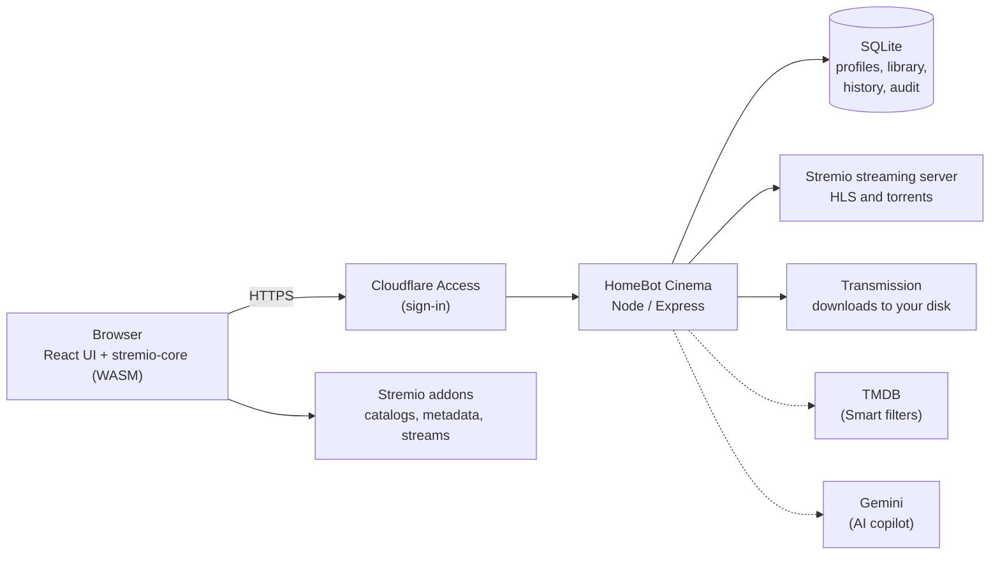

<div align="center">


# HomeBot Cinema

**A private, self-hosted media hub for the whole household.**
A profile for everyone, your own server library, downloads to your own disk, new episodes fetched automatically,
smart discovery, and an AI copilot that only suggests: you press the button.

[](LICENSE.md)
[](.nvmrc)
[](docker-compose.example.yml)
[](https://github.com/Stremio/stremio-web)


</div>

## What is it?

HomeBot Cinema is a fork of [Stremio Web](https://github.com/Stremio/stremio-web) turned into a small media server for a
family or a flat share. The familiar Stremio player and addon catalogs are still there; around them it adds the things a
household needs: separate profiles with their own watch history, a library of what is on your server, downloads that land
on your own disk, shows that keep themselves up to date, and a copilot you can ask what to watch tonight.

It runs on a machine you own (a Mac mini, a NAS, a mini PC), is reached through [Cloudflare Access](https://www.cloudflare.com/zero-trust/products/access/)
so only the people you invite can sign in, and keeps everything (profiles, history, library, settings) in one SQLite
file and one folder you can back up.

> HomeBot Cinema is an independent project. It is **not affiliated with or endorsed by Stremio** or Smart Code OOD.
> See [Responsible use](#responsible-use) and [Credits](#credits--licenses).

## Features

### For the household
- **Profiles for everyone** (up to 8): a "Who's watching?" screen, avatars, an optional PIN, and a **kids** profile.
  Each profile has its own library, Continue watching, watch progress and settings.
- **Home hero banner** and rows built from your addons, with *Continue watching* that follows each profile.
- **Smart filters** (`Discover > Smart filters`): find titles by rating, votes, genre, language, runtime, year and
  "on a streaming service in your country", powered by [TMDB](https://www.themoviedb.org). 40 ready-made quick picks
  (charts, genres, languages, short on time), a hover info panel, and a kid-safe mode.
- **Phone friendly and installable** as a PWA; interface zoom (default 90%); a clean full-screen layout on small screens.

### AI copilot


Click the sparkle button in the top bar and ask: *"something light under two hours"*, *"what did I leave unfinished?"*,
*"is season 3 on the server?"*, *"download this in 1080p"*, *"keep this show updated"*.

- Powered by Google Gemini with a short, live summary of the profile (titles only: **no names, emails or PINs**) and a
  fixed set of tools: TMDB search and details, your server library, downloads and watch history.
- **It can only stage.** A download (one movie or episode, best live release for your quality profile) or a monitor
  (admins only) appears as a card with *Confirm* and *Cancel*. Nothing starts until you confirm, only the login and
  profile that staged it can confirm, and it expires after 10 minutes.
- Guarded against claiming things it did not do, against inventing titles (cards only show titles a tool returned), and
  rate limited per login. Kids profiles get child-friendly results and cannot stage anything.
- Needs a `GEMINI_API_KEY`; hidden for everyone but admins until it is set.

<br clear="right">

### Your server
- **Downloads to your own disk** through Transmission, with **quality profiles** (4K Ultra HD, 4K Efficient,
  HD Balanced, Direct Play, Space Saver, or your own) that set resolution, size limits and keywords, and a **swarm check**
  that tells you whether a release has live peers before you start it.
- **Sentinel** keeps shows up to date: monitor a series for *new episodes only*, chosen *seasons*, or *all* of it. It
  picks the best release under the show's quality profile, remembers what you deleted so it never re-downloads it, and can
  alert you on Telegram.
- **Server library**: scans your movie and TV folders, matches titles, plays straight from the server, badges what is
  new, and marks episodes on the Calendar.
- **Player**: HLS with a deep buffer (90 to 240 s ahead), HEVC re-encoded to H.264 for smooth playback, subtitles from
  addons, and signed, expiring links for external players such as VLC.
- **Admin panel**: overview, people, activity log and quality profiles.
- **Live updates** (server-sent events) so downloads and the library refresh without reloading, and a daily database
  snapshot (the last 7 are kept).

## Screenshots

| | |
|:---:|:---:|
|  |  |
| **Smart filters** with the hover info panel | **Title page** with sources and the download bar |
|  |  |
| **Downloads** and **Sentinel** (auto-download) | **Server library** |

<p align="center">
  
  &nbsp;
  
  &nbsp;
  
</p>

## How it fits together



Dotted lines are optional. The UI is Stremio Web (React); the brains of discovery and playback still live in
[stremio-core](https://github.com/Stremio/stremio-core) compiled to WebAssembly. Everything household-specific is in
`http_server.js` and `server/`; [`AGENTS.md`](AGENTS.md) is the map of the code.

## Quick start

You need Docker with Compose, a folder for movies and one for shows.

```sh
git clone https://github.com/Kanakjr/homebot-cinema.git && cd homebot-cinema

cp .env.example .env                              # 1. fill in the values (see Configuration)
cp data/addons.example.json data/addons.json      # 2. the addons your household sees
cp docker-compose.example.yml docker-compose.yml  # 3. point ./media/Movies and ./media/TV at your folders

docker compose up -d --build                      # 4. first build takes a few minutes
```

Then open <http://localhost:3002>, pick or create a profile, and you are in.

**Signing in.** On a real server, put the app behind Cloudflare Access (a Cloudflare Tunnel plus an Access application)
and set `CF_TEAM_DOMAIN`, `CF_ACCESS_AUD` and `ADMIN_EMAILS` in `.env`: the app verifies Cloudflare's signed token on
every request and refuses everything otherwise. To try it on your own computer, uncomment the two *local trial* lines in
`docker-compose.yml` (`NODE_ENV=development`, `DEV_EMAIL=you@example.com`). They let anyone who can reach the port in as an
admin, so never use them on a server other people can reach.

**Addons.** `data/addons.json` is the list every profile gets (same format as a Stremio addon collection: a
`transportUrl` and the addon's `manifest`). The example ships metadata, subtitle and public-domain addons only. Which
sources you add is up to you.

**Optional, but nice:** a free [TMDB key](https://www.themoviedb.org/settings/api) turns on Smart filters, and a
[Gemini key](https://aistudio.google.com/apikey) turns on the copilot.

## Configuration

All settings are environment variables; [`.env.example`](.env.example) has every one with a comment.

| Variable | What it does |
|---|---|
| `CF_TEAM_DOMAIN`, `CF_ACCESS_AUD` | Cloudflare Access team and application audience used to verify logins. Without them the server answers 503 |
| `ADMIN_EMAILS` | Comma-separated logins that are admins (admin is a login, not a profile) |
| `OWNER_PROFILE_NAME` | Name of the profile created for the first login |
| `STREMIO_SERVER_HOST/PORT`, `TRANSMISSION_HOST/PORT` | Where the streaming server and Transmission are (defaults match the example compose) |
| `LIBRARY_MOVIES_DIR`, `LIBRARY_TV_DIR` | Media folders as seen inside the container |
| `STREAM_ADDON_URL` | The Stremio stream addon Sentinel and the copilot ask for releases (base URL or install link). **No default**: without it they find nothing |
| `TMDB_API_KEY`, `WATCH_REGION` | Smart filters, and the country whose streaming catalogs are searched |
| `GEMINI_API_KEY`, `GEMINI_MODEL` | The AI copilot |
| `TELEGRAM_BOT_TOKEN`, `TELEGRAM_CHAT_ID` | Optional Sentinel alerts |
| `PUBLIC_HOSTS`, `DASHBOARD_URL` | Optional: extra browser-facing hostnames, and a link to a companion dashboard |
| `HLS_FORCE_H264` | `0` stops forcing H.264 on HLS transcodes |

## Development

Node.js 22+ and [pnpm](https://pnpm.io) 11+.

```sh
pnpm install
pnpm build            # UI -> build/
pnpm test             # UI tests (jest)
pnpm test:server      # backend tests (node:test)
pnpm lint
```

Run the whole app with a dev login (only on your own machine):

```sh
pnpm test:server      # once: caches express + jose into .cache/
NODE_PATH=$PWD/.cache/server-deps/node_modules NODE_ENV=development DEV_EMAIL=you@example.com ADMIN_EMAILS=you@example.com \
  node --disable-warning=ExperimentalWarning http_server.js         # http://localhost:8080
```

`pnpm start` runs only the webpack dev server (hot reload, no backend). See [CONTRIBUTING.md](CONTRIBUTING.md).

## Security and privacy

- **Fails closed.** No valid Cloudflare Access token means no API access. The dev login only works with `NODE_ENV=development`.
- **Your data stays with you.** Profiles, history and settings live in `data/` on your machine. The only outside calls are
  to the addons you list, TMDB (if enabled) and Gemini (if enabled).
- **The copilot sees titles only**, never emails, profile names or PINs, and can only *stage* actions you confirm.
- Stream links for external players are **signed and expire**; media paths must live inside your configured library
  folders; stream responses are never cached.
- Secrets live in `.env` and `data/`, both git-ignored. Please report vulnerabilities privately through GitHub's
  *Report a vulnerability* feature rather than a public issue.

## Responsible use

HomeBot Cinema does not host, index, provide or recommend any media. It is a client for the sources you configure
(Stremio-compatible addons, your own files) and a manager for your own server. **You** decide what to point it at, and you
are responsible for following the laws, licenses and terms of service that apply where you live and to the services and
content you use. Use it for media you have the right to access.

## Credits and licenses

- Built on [**Stremio Web**](https://github.com/Stremio/stremio-web) by Smart Code OOD (GPL-2.0), together with
  [stremio-core](https://github.com/Stremio/stremio-core), [stremio-video](https://github.com/Stremio/stremio-video) and
  [stremio-translations](https://github.com/Stremio/stremio-translations). "Stremio" is a trademark of its owner; this
  project is not endorsed by it.
- Discovery data and images come from [TMDB](https://www.themoviedb.org): *this product uses the TMDB API but is not
  endorsed or certified by TMDB.* Recommendations use [Google Gemini](https://ai.google.dev).
- The logo, brand assets and profile avatars are original artwork made for this project
  ([`scripts/brand`](scripts/brand)).
- Posters, backdrops and descriptions shown in the app come from the addons and services you configure and belong to
  their respective owners.

Released under the **GNU General Public License v2.0**, like the project it is based on. See [LICENSE.md](LICENSE.md).
Copyright © 2017-2026 Smart Code OOD and the HomeBot Cinema contributors.
