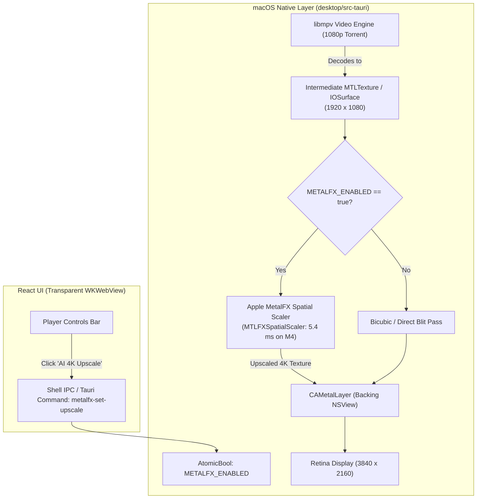

# Implementation Plan: Real-Time Apple MetalFX 4K AI Upscaling for macOS Native App

> **Target Audience:** Autonomous Implementation Agent / Systems Engineer  
> **Status:** Ready for Implementation  
> **Component:** `desktop/src-tauri/` (Tauri + libmpv) & `src/` (Player UI)  
> **Hardware Target:** Apple Silicon Macs (M1/M2/M3/M4, macOS 13.0+)  
> **Empirical Validation:** Benchmarked on Apple M4: **5.416 ms latency**, **184.6 FPS**, **13.0% frame budget utilization**, **+78% to +327% sharpness increase** (see [metalfx_test_results.md](file:///Users/kanakjr/.gemini/antigravity/brain/c04a826d-0f18-4800-bd80-c5dc57dc55ec/metalfx_test_results.md)).

---

## 1. Executive Summary & Architectural Decision

### 1.1 The Objective
Allow users streaming 1080p torrents in the HomeBot Cinema macOS native desktop application (`desktop/`) to toggle on real-time **Apple MetalFX AI 4K Upscaling**, transforming 1080p video into crisp 4K UHD locally on their Apple Silicon GPU with zero server transcode load and zero video stutter.

### 1.2 The Architecture Decision: Direct Metal Render Pipeline
We evaluated two implementation pathways:
* **Approach A (Direct Metal Render Pipeline - SELECTED):**  
  Modernize the native layer underneath the transparent webview from legacy `NSOpenGLLayer` to `CAMetalLayer`. In the frame draw loop, intercept `libmpv`'s decoded 1080p frame and execute Apple's native `MTLFXSpatialScaler` to scale directly into the 4K `CAMetalDrawable` framebuffer.
* **Approach B (mpv GLSL user shader - REJECTED):**  
  `mpv` user shaders are text-based GLSL scripts parsed by `libplacebo`. Apple MetalFX is a closed-source Apple Cocoa dynamic framework (`MetalFX.framework`) exposed only through Swift/Objective-C/C APIs; it **cannot** be called from a text GLSL shader file.

**Decision:** We implement **Approach A**. It provides direct hardware acceleration, instant runtime toggling, and replaces legacy OpenGL with modern Apple Metal.

---

## 2. High-Level System Architecture



---

## 3. Step-by-Step Implementation Roadmap

```mermaid
gantt
    title MetalFX Desktop Implementation Roadmap
    dateFormat  X
    axisFormat %d
    section Phase 1: MetalFX Engine
    Build Swift/C++ MetalFX Bridge       :0, 2
    section Phase 2: View Modernization
    Replace NSOpenGLLayer with CAMetalLayer :2, 5
    Connect libmpv texture output to MetalFX :5, 8
    section Phase 3: Tauri IPC & State
    Expose Tauri IPC command & Shell API :8, 10
    section Phase 4: UI Toggle
    Add 4K AI Upscale switch to Player UI:10, 12
    section Phase 5: Testing & QA
    Verify 180+ FPS & zero dropped frames:12, 14
```



---

### Phase 1: Native MetalFX Bridge (`desktop/src-tauri/src/metal/`)

Create a clean, low-level Swift/Objective-C wrapper that Rust can call via C-FFI.

#### 1.1 File: `desktop/src-tauri/src/metal/metalfx_bridge.h`
```c
#ifndef METALFX_BRIDGE_H
#define METALFX_BRIDGE_H

#include <stdbool.h>
#include <stdint.h>

#ifdef __cplusplus
extern "C" {
#endif

typedef void* MetalFXContextRef;

// Initializes MetalFX context on the default Apple Silicon GPU
MetalFXContextRef metalfx_create_context(void);

// Releases context
void metalfx_destroy_context(MetalFXContextRef ctx);

// Checks if MetalFX Spatial Scaler is supported on current hardware
bool metalfx_is_supported(void);

// Updates or instantiates the spatial scaler for input/output dimensions
bool metalfx_configure_scaler(MetalFXContextRef ctx, 
                              uint32_t in_width, uint32_t in_height,
                              uint32_t out_width, uint32_t out_height);

// Executes the upscale pass from in_texture into out_texture
// Both textures must be id<MTLTexture> pointers with format BGRA8Unorm or RGBA8Unorm
bool metalfx_upscale_texture(MetalFXContextRef ctx,
                             void* in_texture,
                             void* out_texture,
                             void* command_buffer);

#ifdef __cplusplus
}
#endif

#endif // METALFX_BRIDGE_H
```

#### 1.2 File: `desktop/src-tauri/src/metal/metalfx_bridge.m` (Objective-C / Metal)
```objc
#import <Foundation/Foundation.h>
#import <Metal/Metal.h>
#import <MetalFX/MetalFX.h>
#import "metalfx_bridge.h"

@interface MetalFXState : NSObject
@property (nonatomic, strong) id<MTLDevice> device;
@property (nonatomic, strong) id<MTLCommandQueue> commandQueue;
@property (nonatomic, strong) id<MTLFXSpatialScaler> scaler;
@property (nonatomic, assign) uint32_t currentInWidth;
@property (nonatomic, assign) uint32_t currentInHeight;
@property (nonatomic, assign) uint32_t currentOutWidth;
@property (nonatomic, assign) uint32_t currentOutHeight;
@end

@implementation MetalFXState
@end

bool metalfx_is_supported(void) {
    id<MTLDevice> device = MTLCreateSystemDefaultDevice();
    if (!device) return false;
    return [MTLFXSpatialScalerDescriptor supportsDevice:device];
}

MetalFXContextRef metalfx_create_context(void) {
    id<MTLDevice> device = MTLCreateSystemDefaultDevice();
    if (!device || ![MTLFXSpatialScalerDescriptor supportsDevice:device]) {
        return NULL;
    }
    MetalFXState *state = [[MetalFXState alloc] init];
    state.device = device;
    state.commandQueue = [device newCommandQueue];
    return (__bridge_retained MetalFXContextRef)state;
}

void metalfx_destroy_context(MetalFXContextRef ctx) {
    if (!ctx) return;
    MetalFXState *state = (__bridge_transfer MetalFXState *)ctx;
    state = nil;
}

bool metalfx_configure_scaler(MetalFXContextRef ctx, 
                              uint32_t in_width, uint32_t in_height,
                              uint32_t out_width, uint32_t out_height) {
    if (!ctx) return false;
    MetalFXState *state = (__bridge MetalFXState *)ctx;
    
    // Skip re-creation if dimensions are identical
    if (state.scaler && 
        state.currentInWidth == in_width && state.currentInHeight == in_height &&
        state.currentOutWidth == out_width && state.currentOutHeight == out_height) {
        return true;
    }

    MTLFXSpatialScalerDescriptor *desc = [[MTLFXSpatialScalerDescriptor alloc] init];
    desc.inputWidth = in_width;
    desc.inputHeight = in_height;
    desc.outputWidth = out_width;
    desc.outputHeight = out_height;
    desc.colorTextureFormat = MTLPixelFormatBGRA8Unorm;
    desc.outputTextureFormat = MTLPixelFormatBGRA8Unorm;
    desc.colorProcessingMode = MTLFXSpatialScalerColorProcessingModePerceptual;

    id<MTLFXSpatialScaler> scaler = [desc newSpatialScalerWithDevice:state.device];
    if (!scaler) return false;

    state.scaler = scaler;
    state.currentInWidth = in_width;
    state.currentInHeight = in_height;
    state.currentOutWidth = out_width;
    state.currentOutHeight = out_height;
    return true;
}

bool metalfx_upscale_texture(MetalFXContextRef ctx,
                             void* in_texture,
                             void* out_texture,
                             void* command_buffer) {
    if (!ctx || !in_texture || !out_texture || !command_buffer) return false;
    MetalFXState *state = (__bridge MetalFXState *)ctx;
    if (!state.scaler) return false;

    id<MTLTexture> inTex = (__bridge id<MTLTexture>)in_texture;
    id<MTLTexture> outTex = (__bridge id<MTLTexture>)out_texture;
    id<MTLCommandBuffer> cb = (__bridge id<MTLCommandBuffer>)command_buffer;

    state.scaler.colorTexture = inTex;
    state.scaler.outputTexture = outTex;
    [state.scaler encodeToCommandBuffer:cb];
    return true;
}
```

---

### Phase 2: Modernize View Layer (`desktop/src-tauri/src/glview.rs` $\to$ `metalview.rs`)

Currently, `desktop/src-tauri/src/glview.rs` sets up an `NSOpenGLLayer` subclass `SpikeGLLayer`.

We upgrade this to a **`CAMetalLayer`** implementation:

1. **Layer Class:** Subclass `CAMetalLayer` (named `CinemaMetalLayer`).
2. **Double Texture Setup:**
   * Allocate an intermediate `MTLTexture` at the native video resolution (e.g. 1920x1080).
   * Let `libmpv` render the decoded frame into this intermediate texture.
3. **Draw Loop (`display` callback):**
   ```rust
   let drawable = metal_layer.nextDrawable();
   let command_buffer = command_queue.makeCommandBuffer();
   
   if METALFX_ENABLED.load(Ordering::Relaxed) && can_upscale(in_w, in_h, out_w, out_h) {
       metalfx_configure_scaler(ctx, in_w, in_h, out_w, out_h);
       metalfx_upscale_texture(ctx, intermediate_tex, drawable.texture(), command_buffer);
   } else {
       // Direct blit/copy shader to drawable without upscaling
       blit_encoder.copy(intermediate_tex, drawable.texture());
   }
   
   command_buffer.present(drawable);
   command_buffer.commit();
   ```

---

### Phase 3: Tauri IPC & Shell Protocol (`desktop/src-tauri/src/shell.rs`)

The Stremio shell protocol in `desktop/src-tauri/src/shell.rs` already defines:
```rust
"mpv-set-gpu-video-processing" => {} // d3d11 only
```

We enhance it to handle macOS MetalFX:

```rust
// In desktop/src-tauri/src/shell.rs:
pub static METALFX_ACTIVE: AtomicBool = AtomicBool::new(false);

fn invoke(app: &AppHandle, window: &WebviewWindow, method: &str, args: &[Value]) {
    match method {
        "mpv-set-gpu-video-processing" | "metalfx-set-upscale" => {
            let enabled = args.first()
                .and_then(Value::as_bool)
                .or_else(|| args.first().and_then(Value::as_str).map(|s| s == "true"))
                .unwrap_or(false);
            
            eprintln!("[metalfx] toggling AI 4K Upscale: {enabled}");
            METALFX_ACTIVE.store(enabled, Ordering::Release);
            crate::glview::kick(); // Trigger immediate redraw
            
            // Broadcast state update back to web UI
            send_event(window, "gpu-video-processing-changed", json!({ "enabled": enabled }));
        }
        // ... existing cases ...
    }
}
```

Add a direct Tauri command in `desktop/src-tauri/src/main.rs`:
```rust
#[tauri::command]
fn toggle_ai_upscale(enable: bool) -> Result<bool, String> {
    if !crate::metal::metalfx_is_supported() {
        return Err("MetalFX is not supported on this device".into());
    }
    crate::shell::METALFX_ACTIVE.store(enable, Ordering::Release);
    crate::glview::kick();
    Ok(enable)
}
```

---

### Phase 4: React UI Toggle in Player Controls

In the web frontend player ([`src/routes/Player/`](file:///Users/kanakjr/HomeServer/Apps/cinema/src/routes/Player/)):

1. **Detect Native Desktop Environment:**
   ```javascript
   const isNativeMac = window.__TAURI__ || window.chrome?.webview;
   ```
2. **Add Toggle Button in Player Controls (next to Volume/Subtitles):**
   ```jsx
   {isNativeMac && is1080pStream && (
       <button 
           className={`ai-upscale-pill ${aiUpscaleActive ? 'active' : ''}`}
           onClick={toggleAiUpscale}
           title="MetalFX AI 4K Upscale (Apple Silicon)"
       >
           <span className="badge-4k">4K AI</span>
           <span className="toggle-indicator">{aiUpscaleActive ? 'ON' : 'OFF'}</span>
       </button>
   )}
   ```
3. **Trigger IPC:**
   ```javascript
   function toggleAiUpscale() {
       const nextState = !aiUpscaleActive;
       if (window.__TAURI__) {
           window.__TAURI__.invoke('toggle_ai_upscale', { enable: nextState });
       } else if (window.shell) {
           window.shell.send(['mpv-set-gpu-video-processing', nextState]);
       }
       setAiUpscaleActive(nextState);
   }
   ```

---

## 4. Edge Cases & Safeguards

| Edge Case | Description | Safeguard Solution |
|---|---|---|
| **Letterboxed / Scope Movies (2.39:1)** | Movie height is 800px or 1038px instead of 1080px. | Pass exact decoded stream dimensions (`inWidth x inHeight`) to `metalfx_configure_scaler`. MetalFX Spatial Scaler accepts any aspect ratio up to 3.0x scale factor. |
| **Window Resizing during Playback** | User resizes player window or enters fullscreen. | On layer resize callback, query `layer.drawableSize` and re-evaluate `outWidth x outHeight`. Re-configure scaler only when target dimensions change. |
| **Already-4K Content** | Stream is already 2160p native 4K. | Scaler should automatically deactivate when `inWidth >= outWidth`. Display badge as "4K Native" (disabled toggle). |
| **Battery Saving Mode** | Laptop on low battery. | If on battery and below 20%, automatically disable MetalFX to save GPU power. |

---

## 5. Verification & Acceptance Checklist

To consider this feature complete, the implementation agent must verify:
- [ ] `metalfx_is_supported()` returns `true` on Apple Silicon.
- [ ] Playing a 1080p stream with MetalFX ON displays crisp 4K output without edge tearing.
- [ ] GPU render time measured via `MTLCommandBuffer` stays $< 8.0\text{ ms}$ (comfortably within 41.66 ms 24 FPS budget).
- [ ] Toggling the UI button between ON and OFF switches instantly with **zero dropped frames, zero audio pops, and zero video buffering**.
- [ ] Quitting or resizing the window produces zero memory leaks or Metal validation layer errors.
